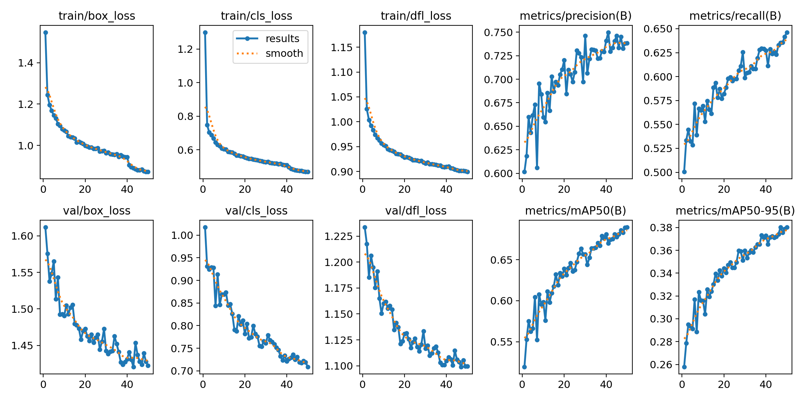
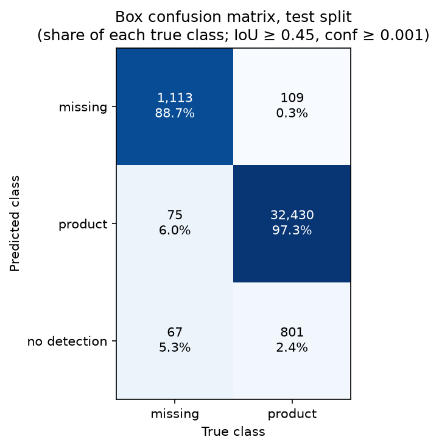
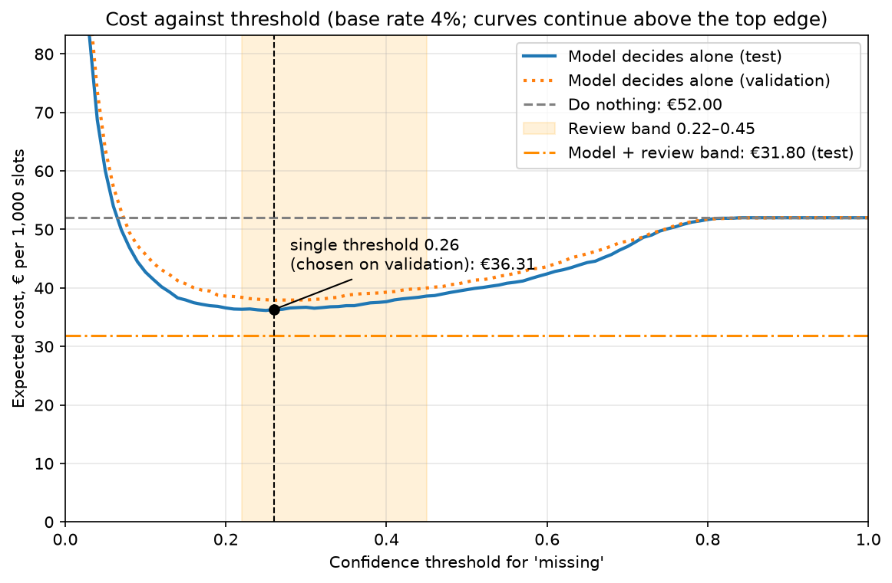

# Assignment 2 Report

- **Name**: Yago Moreno
- **Student ID**: 19134
- **Email**: ymoreno.ieu2022@student.ie.edu
- **Group**: [BBADBA 5A]

## 1. Business problem, and the cost of being wrong

**The setting.** I imagine a mid-sized supermarket of about 1,500 m² in Madrid. Staff photograph about 150 shelf sections twice a day. That gives 300 photos of roughly 150 slots each, or **45,000 slot decisions a day**. Gaps on the shelf mean lost sales until someone notices them. Today that depends on staff walking the aisles, which is slow and misses things. This is the "do nothing" option that I price in Section 7.

**The decision.** For every shelf slot, should someone go and restock it now? Each slot ends in one of three outcomes:

- **Pass:** nothing happens. If the slot is in fact empty, the next manual round will still catch it.
- **Review:** the model is unsure, and a shift supervisor looks at a cropped photo for about 4 seconds and decides.
- **Restock (fail):** the model is confident the slot is empty, and an alert goes to a restocker's handheld.

**Why the unit is the slot, not the photo.** I first considered asking "does this photo contain a gap?". In the test set 94% of photos contain at least one gap, so the answer is almost always yes and tells a store nothing. The action also happens per slot: someone walks to one spot and refills it. So one case is one slot.

**What each outcome costs.** I priced every outcome in euros. These figures are my own estimates, not measured data.

| Outcome | Cost | Where it comes from |
|---|---|---|
| Missed gap (FN) | €1.30 | About 0.6 units/h demand for a slot × 6 h on average until a manual round catches it × 40% of that demand lost to the store × €0.90 gross margin per unit ≈ €1.30 |
| False alarm (FP) | €0.40 | A restocker at €16/h loaded cost wastes about 1.5 min walking to a slot that is full |
| Correct alert (TP) | €0.30 | Only the extra trip outside the normal round, about 1 min at €16/h (≈ €0.27, rounded up). The round would restock the gap anyway, so the model only moves the work earlier |
| Correctly ignored (TN) | €0 | Nothing happens |
| Review | €0.02 | A supervisor at €20/h × 4 s |

The €0.90 is an assumed average item price of €3.60 at a 25% gross margin. I use gross margin because a lost sale loses the margin on the item, not the net profit, since rent and staff are paid anyway. I have not verified it against a Spanish grocer's accounts. The wages (€16/h loaded cost for a restocker, €20/h for a supervisor) are also my assumptions. The 6 h is an average, and it assumes that photo rounds and manual rounds are spread across the day.

The 40% of demand lost to the store follows the multi-country study by Gruen, Corsten & Bharadwaj (2002), *Retail Out-of-Stocks: A Worldwide Examination of Extent, Causes and Consumer Responses* (GMA / FMI / CIES). It reports that on average about 31% of shoppers go to another store when they can't find an item, and about 9% don't buy at all. I have not read the full study: the 31% comes from the FMI press release about it, and the 9% from a secondary summary table. It is a 2002 average across countries, not a Spanish measurement.

**The asymmetry.** A missed gap costs about 3× a false alarm (€1.30 vs €0.40), so the system should lean towards flagging. In theory a slot is worth flagging when the chance it is empty exceeds FP ÷ (FN − TP + FP) = 0.40 ÷ 1.40 ≈ **0.29**. Section 6 uses this again.

**The assumption I most need to defend: 0.6 units/h.** A realistic store of this size sells about 2,000 tickets a day of about 9 items each, or 18,000 items (about €65,000 a day at €3.60 an item, the same order of magnitude as a store of a large Spanish chain; I have not verified this). Over a 12 h day and about 22,500 slots, that is an average of about 0.07 units/h per slot. So my 0.6 is about 9× the store average. I use it because gaps appear mostly on fast sellers, which are the products that run out. As a rough argument: if a slot's chance of being empty grows with how fast it sells, the typical empty slot sells at the demand-weighted average, which exceeds the plain average by a factor of 1 + CV², where CV measures how uneven sales are across slots. Reaching 9× needs very uneven sales (CV about 2.8). I did not measure this, and the pilot would.

The consequence is that the design does not pay on an average slot. At 0.07 units/h a missed gap costs only about €0.15, less than the €0.30 extra trip. The system pays because gaps concentrate on fast sellers. It stops paying when empty slots sell below about 0.16 units/h, which is a missed-gap cost of about €0.35 and about 2.4× the store average. Section 6 tests this.

## 2. Dataset

**Source.** I used the Roboflow Universe dataset *Empty spaces in a supermarket hanger*, **version 26**: https://universe.roboflow.com/final-project-object-detection-for-instore-inventory-management/empty-spaces-in-a-supermarket-hanger-1upsp. It is licensed **CC BY 4.0**, so I credit it here: the workspace *Final project object detection for instore inventory management* on Roboflow Universe.

**What one example looks like.** Most images are portrait phone photos of a supermarket shelf section at 1536×2048, with some other sizes (for example 1152×2048 portrait or 2048×1536 landscape). The validation and test photos hold a median of about 140 to 150 labelled slots, and the visible slots are labelled with boxes (not always completely, see Section 3). The photos resemble the well-known SKU-110K collection, and they come from more than one country. At least some are from US stores (Walmart "Rollback" signs are visible in a test photo). Some training photos appear to be from German drugstores (German shelf labels such as "Hornhaut", and the dm own-brand Balea). I have not verified the origin of every photo. None of them is a Spanish store, which matters for Section 8.

**Classes.** The two classes that matter are **missing** (an empty slot, which is what the system must find) and **product** (a filled slot). The dataset also contains two near-empty classes, `-` and `\`, which I discuss in Section 3.

**Why it fits my problem.** Section 1 turns the problem into one decision per slot. That needs labels on both empty and filled slots, because filled slots are the negatives the system must not flag. Without them I could not measure false alarms, which are priced in Section 1. This dataset has about 500,000 labelled product slots and about 18,000 gaps in training, although about half of the training boxes are augmented copies (see Section 3).

**Datasets I considered and rejected.** The assignment requires at least two classes. I also rejected datasets that met that rule but had too few gaps to trust. Class lists and image counts were checked through the Roboflow API on 27 October 2026.

| Dataset | Images | Classes (instances) | Why rejected |
|---|---|---|---|
| Out Of Stock detection | 1,013 | empty (5,240) | One class. Large enough, but there are no filled slots to count false alarms against |
| Empty Shelf Detector | 198 | 100% O.O.S (1,093) | One class, same reason |
| Supermarket Shelves (COSC428) | 150 | Missing 300, Product 1,482, Unfaced 692 | Good classes, but only 300 gap labels, so per-class results would rest on very few gaps |
| Product on shelves | 245 | empty 455, product 17,110, plus shelf, main_shelf, tag and a stray "0" with no instances | Small (455 gaps) and messy extra classes |

## 3. What the dataset's composition implies

| Split | Images | Median boxes per image | missing boxes | product boxes | Gaps as share of labelled slots |
|---|---|---|---|---|---|
| train | 1,958 | 253 | 17,953 | 503,301 | 3.4% |
| valid | 231 | 148 | 1,395 | 34,601 | 3.9% |
| test | 232 | 139 | 1,255 | 33,340 | 3.6% |

**Gaps are rare.** In the test set there are about 27 filled slots for every empty one, so about 1 label in 28 is a gap. Three consequences follow:

- Accuracy is useless as a metric. A "model" that always says "full" would be right on 96.4% of test slots and catch no gap at all. So I report per-class results (Section 5) and cost in euros (Section 6).
- 18,000 gap labels is not small in absolute terms, but training is dominated by product labels. This is one reason the missing class scores lower than product (Section 5).
- I assume a base rate of **4%** for my store, slightly messier than the dataset. The cost calculation rescales to it, and Section 6 tests 2% and 8%.

**Gaps are small.** The median gap covers about 0.3% of a test photo. On a typical portrait photo that is about 27×39 pixels at 640 px and about 42×62 pixels at 1024 px, which is why resolution mattered (Section 4).

**Almost every photo has a gap.** 219 of 232 test photos (94%) contain at least one. A photo-level question is therefore almost always "yes", which supports using the slot as the unit (Section 1).

**The training split is augmented.** Roboflow's augmentation roughly doubled the training split, and 885 of the 1,958 training images (45%) are 2×2 mosaics of four shelf photos stitched into one 2048×2048 square. The project has about 1,444 source images. Validation and test hold 463, which leaves about 980 distinct training photos, and 980 × 2 ≈ 1,958. The mosaics explain two differences between training and test:

- A training image has a median of 253 boxes against about 140 to 150 in test, because it holds four photos' worth of slots.
- Training gaps look smaller (median 0.23% of the image against 0.32% in test), because each photo is shrunk to a quarter of the picture.

Validation and test were not augmented and no source photo appears more than once, so test results reflect real photos, not copies of training data.

**Two junk classes.** `-` and `\` have 2 boxes each in training and none in validation or test. They are labelling noise, so no number for them can be trusted, and I ignore them.

**The labels are incomplete.** In a visual check of 24 of the 62 restock phantoms with no labelled slot nearby (Section 5), most looked like real empty spaces that the annotators had not labelled, such as dark gaps between products. A few were clearly wrong (a 7Up box, a cardboard panel), and some were too blurry to judge. This is a judgement on a small sample, not a measurement. If it holds, the test set undercounts real gaps, and precision for `missing` looks worse than it really is.

**The test sample.** 1,255 gaps is enough for a fairly stable estimate on the missing class. If the boxes were independent, the box-level recall of 0.478 (Section 5) would carry about ±2.8 percentage points at 95% confidence. They are not independent, because they cluster in 232 photos, so the true uncertainty is larger.

**What I can't conclude.** The photos are frontal shots of dry goods, so results only hold for that kind of photo (Sections 5 and 8).

## 4. Finetuning and baselines

**What I trained.** I finetuned **YOLO11n**, the smallest ("nano") model in the YOLO family of object detectors. It starts from weights pretrained on COCO, a general dataset of 80 everyday objects, and learns the dataset's classes, of which two matter (`missing` and `product`). The 1024 px run used 50 epochs, batch size 8, seed 0, and took about 1.4 hours on a Colab T4 GPU. The 640 px run used 50 epochs, seed 0 and the default batch size of 16; I did not record its training time. The trained weights are in `weights/best.pt`, and the dashboard runs with `uv run python main.py app`.

*Training curves for the 1024 px run: the losses are still falling and the validation mAP50 is still rising slightly at epoch 50, so more epochs might help (not tested). Precision and recall here average both classes.*

**Why detection rather than classification.** One photo holds about 150 slots. The system must say *which* slot is empty so that someone can walk to it. A model that labels a whole photo, or even a whole shelf, cannot do that.

**Why 1024 px.** I first trained at 640 px. At that size a typical gap is only about 27×39 pixels and hard to see. At 1024 px it is about 42×62. All metrics are on the test split.

| | 640 px | 1024 px |
|---|---|---|
| mAP50 (both classes) | 0.689 | 0.713 |
| missing AP50 | 0.506 | 0.533 |
| missing recall (box level) | 0.433 | 0.478 |
| € per 1,000 slots (model + review) | 32.26 | 31.80 |
| Reviews per day in the chosen band | 978 | 881 |

Both bands were chosen on validation under the same one-hour review cap. On test, the 640 band sends 978 reviews a day, slightly over the 900 the cap allows, while the 1024 band stays within it. So 1024 px is cheaper and needs less review time. The euro gain is modest (€0.46 per 1,000 slots, about €21 a day). Each setting was trained once, so I can't separate a small gain from run-to-run noise. The batch size also changed (16 → 8, to fit 1024 px in GPU memory), so this is not a pure test of resolution. The evidence is that all four quality metrics moved in the same direction.

**Baselines.** I compared the finetuned model against two baselines on the same test split, at slot level and at the 4% base rate.

| Model | Gaps caught | € per 1,000 slots |
|---|---|---|
| COCO YOLO11n zero-shot | 0 | 52.00 |
| Trivial (predict nothing) | 0 | 52.00 |
| Finetuned (single threshold 0.26) | 659 of 1,255 (52.5%) | 36.31 |

COCO's 80 classes include bottles and similar objects but no "empty slot" class. Used as it comes, it never predicts a gap, so it behaves exactly like the trivial baseline. Both cost €52.00, which is simply 40 gaps per 1,000 slots × €1.30, every one of them missed. This is a finding, not a bug: **finetuning was necessary**, because a general model cannot do this task. The finetuned model alone saves €15.69 per 1,000 slots against both baselines, about €706 a day. Section 7 shows that adding the review band saves more.

## 5. Per-class evaluation and failure modes

**Per-class results (test split, 1024 px).**

| Class | Precision | Recall | AP50 | AP50-95 |
|---|---|---|---|---|
| missing | 0.658 | 0.478 | 0.533 | 0.232 |
| product | 0.844 | 0.848 | 0.894 | 0.528 |
| Overall (mean of the two) | | | 0.713 | 0.380 |

**The headline hides the problem.** The overall mAP50 of 0.713 looks respectable, but it is an average of two very different classes. `product` scores 0.894, and `missing`, the class the business needs, scores 0.533. A model that is good at the class I care less about would look fine on the average. This is why the project reports per-class results and cost in euros, not one overall score.

**Two kinds of recall.** I quote two recall figures, and they measure different things:

| | Box-level recall 0.478 | Slot-level recall 0.525 |
|---|---|---|
| Measured by | Ultralytics' standard evaluation | My own slot scoring in `train.py` |
| Confidence cut-off | The one that maximises F1, chosen automatically | 0.26, chosen by cost on validation |
| Matching | One prediction to one labelled box, IoU ≥ 0.5 | A slot counts as caught if any `missing` prediction overlaps it at IoU ≥ 0.5 |

0.478 describes the detector, and I use it to compare the 640 and 1024 runs. 0.525 is what the business decision achieves at the single threshold, and I use it against the baselines.

**Why AP50 and not AP50-95.** The business only needs the model to point at the right slot, and my slot scoring counts a match at IoU ≥ 0.5. So AP50 is the relevant figure. The much lower AP50-95 (0.232) means the predicted boxes are not tight, which does not matter for sending someone to the right spot.

**What the model confuses.** Of the 1,255 true gaps in the test set (box confusion matrix, matched at IoU ≥ 0.45):

- 1,113 were matched to a `missing` prediction,
- 75 were predicted as `product`, for example a gap behind a product pushed forward, or a dark product that looks like a hole,
- 67 had no prediction at all.

The matrix uses Ultralytics' validation default confidence cut-off of 0.001, so almost any faint `missing` box counts. That is why 1,113 of 1,255 (89%) look "found" while the recall at my working threshold is much lower. The same low cut-off produces 44,525 false `missing` boxes on background, so I don't quote the background cells. The other direction: 109 filled slots were predicted as `missing`, and 801 products got no prediction.

*Each column shows the share of one true class. Look at the top-left cell: 88.7% of gaps are matched to a `missing` box, but only at the very permissive confidence of 0.001, so it shows what the detector can find, not what my threshold catches.*

**Why `missing` is weaker (hypotheses, not tested).** Three plausible reasons:

- Gaps are rare, about 1 label in 28 (Section 3).
- Gaps are small, about 0.3% of a photo, so a few pixels of error matter (Section 3).
- A gap looks different each time. It can show a back panel, a bare shelf edge, or a partly hidden space, while products are many and visually consistent.

I did not run experiments to separate these.

**Failure modes I found on my own photos.** I tried two images found online, so they are not from the dataset: a catalogue render with wire racks, and a photo of a meat fridge taken at an angle. These are two anecdotes, not a measured result.

- **Render.** The highest `missing` score was 0.28, in the review band (0.22 to 0.45). So the empty racks went to a supervisor, not straight to restock.
- **Fridge.** At the dashboard's 0.22 cut-off the model found only 3 products out of dozens and missed the gaps. It flagged a dark, perforated back wall as a gap with 0.55 confidence, above the 0.45 restock cut-off, so it would have sent a restocker to a wall. A likely reason is that in training a gap often looks like a dark back panel, but I have not tested this.

Both show that the model only works on the kind of photo it was trained on: frontal shots of dry goods. This is why the scope is limited in Section 8.

**Phantoms.** A phantom is a `missing` box that overlaps no labelled slot at IoU ≥ 0.5. They make up most of the false restock alerts: 130 of the 143 (91%), against 13 filled slots. Of the 654 cases sent to review, 384 (59%) are phantoms. I sorted every phantom on the test split, at the band 0.22 / 0.45, by what it overlaps:

| What the phantom sits on | Restock (≥ 0.45) | Review (0.22–0.45) |
|---|---|---|
| A real labelled gap, badly placed (IoU 0.1–0.5), with no other alert on that gap | 46 | 74 |
| A real gap that already has an alert (duplicate box) | 3 | 37 |
| Partly over a filled slot only | 19 | 66 |
| No labelled slot nearby (IoU < 0.1 with everything) | 62 | 207 |
| **Total** | **130** | **384** |

- The 46 would send a restocker to a real gap, so in practice they are correct alerts. My scoring counts each one as a false alarm and also counts the gap as missed.
- The 3 duplicates cost nothing extra in practice, because it is the same trip.
- Only 19 of the 130 are clearly wrong, plus a minority of the 62 (see the label finding in Section 3).

So the measured cost of false alarms is an **upper bound**, and the model is probably somewhat better than €31.80 suggests. Counting the 120 badly placed boxes (46 restock, 74 review) as the correct alerts they are in practice would lower the cost by up to about €4 per 1,000 slots, from €31.80 to roughly €27.50. This is an upper estimate, because several boxes can sit on the same gap.

## 6. Cost matrix and operating point

**How the cost is calculated.** For every threshold from 0 to 1 in steps of 0.01, I count how many slots end up in each outcome and multiply by the euros from Section 1. I reweight the gap and filled-slot counts to my 4% base rate and express the total per 1,000 slots.

**Phantoms.** Phantoms are charged as false alarms. This is a conservative choice, since some sit on real gaps (Section 5). They are counted per labelled slot as measured and are not rescaled to the 4% base rate, on the assumption that the phantom rate is a property of the photos, not of how many slots are empty. Since some phantoms are unlabelled real gaps, this slightly understates them in a messier store.

**Why the threshold is chosen on validation and reported on test.** A threshold tuned on the same images it is measured on looks better than it really is. So I chose on the validation split and report on the test split, whose number is therefore honest.

**The single threshold.** This is the "model decides alone" design.

| | Value |
|---|---|
| Chosen threshold (validation) | **0.26** |
| Validation cost | €37.90 per 1,000 slots |
| Test cost at 0.26 | **€36.31** |
| Test minimum (at 0.25) | €36.15 |

The two curves agree, and the best test threshold is within 0.01 of the chosen one, so the choice is not overfitted. Compared with doing nothing (€52.00), the single threshold saves €15.69 per 1,000 slots, about €706 a day.

*The validation and test curves agree, and the minimum is flat between about 0.2 and 0.3. The shaded band is the review band of Section 7, and its cost (the dash-dot line) is below the best single threshold. Below a threshold of about 0.05 the cost climbs past €700, so the y-axis is cut at €83.*

**A check against theory.** Flagging a slot is worth it when the expected cost of flagging is lower than the expected cost of ignoring it. If p is the chance that the slot is empty, that is p × TP + (1 − p) × FP < p × FN. This gives:

p > FP ÷ (FN − TP + FP) = 0.40 ÷ (1.30 − 0.30 + 0.40) = 0.40 ÷ 1.40 ≈ **0.29**

The threshold found by data (0.26) is close. This suggests the model's confidence scores behave roughly like probabilities, but I did not test calibration, so the match may be partly luck.

**Sensitivity: which assumption matters most.** I re-ran the sweep with one assumption changed at a time. In every row, both the single threshold and the review band were re-chosen on validation under the same one-hour cap, then priced on test. For the missed-gap rows, the units/h in brackets is the demand that produces that cost (with 6 h, 40% and €0.90 margin). A realistic store average is about 0.07 units/h (Section 1).

| If… | Threshold (single) | Band (review) | Model + review € | Do nothing € |
|---|---|---|---|---|
| Missed gap = €0.35 (0.16 units/h) | 0.73 | 0.42–0.86 | 13.62 | 14.00 |
| Missed gap = €0.48 (0.22 units/h) | 0.53 | 0.33–0.68 | 16.53 | 19.20 |
| Missed gap = €0.60 (0.28 units/h) | 0.47 | 0.28–0.59 | 18.99 | 24.00 |
| Missed gap = €1.30 (0.6 units/h, my figure) | 0.26 | 0.22–0.45 | 31.80 | 52.00 |
| Missed gap = €3.00 (1.4 units/h) | 0.14 | 0.14–0.23 | 57.88 | 120.00 |
| Base rate 2% | 0.41 | 0.23–0.60 | 16.10 | 26.00 |
| Base rate 8% | 0.19 | 0.16–0.26 | 60.46 | 104.00 |
| False alarm = €0.80 | 0.41 | 0.25–0.53 | 33.20 | 52.00 |

The break-even formula predicts the direction of the threshold in every missed-gap and false-alarm row. It is closest when gaps are costly: at €3.00 it gives 0.40 ÷ 3.10 = 0.13 against 0.14 found by data. It is less close when gaps are cheap: at €0.48 it gives 0.69 against 0.53. It does not cover the base-rate rows, because the formula does not depend on the base rate and gives 0.29 in both. There the threshold moves for a different reason: the model's scores were learned on data with about 3.6% gaps, so in a store with more gaps the same score means a higher chance of a real gap.

What to take from it:

- **The cost of a missed gap moves the threshold most.** It runs from 0.47 at €0.60 to 0.14 at €3.00.
- **The decision to use the system holds in every row I tested, but only for fast-selling gaps.** It beats doing nothing in every row. At €0.48 (0.22 units/h) it still saves €2.67 per 1,000 slots. But the saving shrinks from €20.20 at my figure to under €3, and at about €0.35 (0.16 units/h) it is close to zero (about €0.40), because a missed gap then costs barely more than the €0.30 extra trip. Since a realistic store average is only 0.07 units/h, the result depends on empty slots selling at more than twice the average (Section 1).
- **The false-alarm cost matters too.** Doubling it to €0.80 raises the threshold from 0.26 to 0.41. This is the other main lever: if a wasted trip is dearer than I assume, the model should be more selective.
- **A higher base rate pulls the threshold down.** More of the slots are real gaps, so missing them matters more.

The weakest figure is still the missed-gap cost. It rests on my assumptions about demand, the delay, and the share of lost sales (Section 1), and not on measured sales. The pilot in Section 8 would measure it.

## 7. What a person still has to check

**The design.** Each slot's score decides one of three outcomes:

- below **0.22**: pass,
- **0.22 to 0.45**: review,
- **0.45 and above**: restock.

I chose these two thresholds on validation as the cheapest band that fits a cap of one supervisor-hour of review a day. At 4 s a crop, that is 900 reviews a day, or 2.0% of 45,000 slots. I chose one hour as an amount of work a supervisor could absorb without a new hire. That is an assumption, and I come back to its cost below.

**Workload (test split).** 1.96% of slots go to review. That is **881 reviews a day** × 4 s ≈ **59 minutes**, or **0.13 of a full-time person**, using 7.5 productive hours (an 8 h shift minus breaks). With two photo rounds a day it is about 440 crops per round, roughly 30 minutes each, which one supervisor can do on a tablet.

Two caveats:

- On validation the band uses the full 900 reviews a day, and on test it uses 881, which is 2% less. The 640 px model's band moved more (to 978, +9%), so a variation of up to about 10% between batches of photos is plausible.
- The workload grows in proportion to photos per day, so four rounds instead of two would roughly double it.

**Restocker workload.** About 1.9% of slots (roughly 860 a day) become restock alerts. Correct alerts take about 1 extra minute and false alarms about 1.5 minutes, so that is about 14 to 15 hours of walking a day, or about two people's worth. My cost model assumes this replaces work the manual round would do anyway, so I would test it in the pilot.

**What happens on test at these thresholds.**

| | Pass | Review | Restock |
|---|---|---|---|
| Filled slot | 33,283 | 44 | 13 |
| Real gap | 557 | 226 | 472 |
| Phantom (no slot) | — | 384 | 130 |

- **Restock alerts:** 472 of 615 (77%) are real gaps, 13 are filled slots, and 130 are phantoms (Section 5 shows some of those sit on real gaps).
- **Review cases:** 226 of 654 (35%) are real gaps, 44 are filled slots, and 384 (59%) are phantoms. The supervisor dismisses most of the last two groups, though some phantoms sit on real gaps (Section 5).
- **The system acts earlier on 698 of 1,255 gaps (56%):** 472 restocked directly and 226 sent to review, assuming the supervisor judges correctly.
- **557 gaps (44%) are still missed** and wait for the manual round. Section 5 shows that up to 120 phantom boxes (46 restock, 74 review) sit on real gaps that my scoring counts as missed, so 44% is an upper bound.

**Priced against the alternatives (test, € per 1,000 slots).**

| Option | € | Reviews/day | People |
|---|---|---|---|
| Do nothing (manual rounds only) | 52.00 | 0 | 0 |
| A person checks every slot | 32.00 | 45,000 | 6.67 |
| Model decides alone | 36.31 | 0 | 0 |
| Model + review band | 31.80 | 881 | 0.13 |

How to read it:

- **"Do nothing" is today's situation.** It is the "staff walking the aisles" case from Section 1. Its €52.00 is 40 gaps × €1.30, which already prices a gap staying empty until a manual round catches it.
- **My design is the cheapest option.** It saves about **€909 a day** against doing nothing (€20.20 × 45) and about €203 a day against the model alone.
- **Checking every slot costs almost the same (€32.00)**, because a review is only €0.02. But it needs 50 hours of reviewing a day, nearly 7 full-time people, and it assumes the reviewer never misses a gap. That is not realistic.
- **The model alone is already much better than doing nothing.** The review band saves a further €4.51 per 1,000 slots, because a supervisor's 4 s is far cheaper than a wasted trip or a missed gap.

**The cost of the cap.**

| Band | Cost (test) | Reviews/day | People |
|---|---|---|---|
| My design, 0.22–0.45 (one-hour cap) | €31.80 | 881 | 0.13 |
| Half cap, 0.26–0.37 | €33.97 | 441 | 0.07 |
| No cap, 0.03–0.86 | €23.98 | 8,535 | 1.26 |

The cap is a staffing limit, not a cost, because the €0.02 per review already includes the supervisor's wage. Without it the model would be €352 a day cheaper, but it would need 8,535 crops a day, about 9.5 hours of 4-second reviews. That is more than one full-time person doing nothing else. A half cap costs about €98 a day more than my design.

I chose one hour for four reasons:

- **It fits an existing role.** One hour a day can be absorbed by a supervisor without a new hire. Staffing comes in whole people, so 1.26 reviewers in practice means two part-timers or a reassigned employee.
- **Accuracy.** My cost model assumes the reviewer is always right. 9.5 hours a day of 4-second crop checks is monotonous, so accuracy would likely drop, and that assumption is safest at a low volume.
- **The saving rests on the weakest figure.** The €352 depends on the €1.30 missed-gap cost. At €0.48 (0.22 units/h of demand) most of that gain would disappear (Section 6).
- **It still captures most of the saving.** The uncapped band would save about €1,261 a day against doing nothing, and mine saves about €909, which is 72% of that, without a new hire.

A store that valued the extra €352 could reasonably choose otherwise.

**What this assumes.** The supervisor is always right. I did not measure reviewer accuracy, and 4 s per crop is quick, so tired reviewers will make mistakes. The pilot in Section 8 would measure this.

## 8. Limitations & next steps

| Limitation | How I would address it |
|---|---|
| **The model only works on photos like its training data.** These are frontal shots of dry goods. On my two outside images it failed: a fridge at an angle and a catalogue render (Section 5). | Limit the scope to dry-goods aisles. Label a few hundred photos from the real store, including fresh counters, and finetune again. |
| **It misses a large share of gaps.** Between 35% and 44% of gaps are still missed at my thresholds. The upper figure counts badly placed boxes as misses (Section 5). Gaps are only about 3.6% of labels and are small. | Try a bigger model (yolo11s), train for more epochs, and add labelled gap examples. I did not test any of these. |
| **The labels are incomplete and the data does not match my store.** Some real gaps have no box (Section 3), so precision looks worse than it is. The photos are from US and German stores, and the training set contains mosaics (Section 3). | Collect and label photos from Madrid stores, and check the labels on a sample. |
| **The cost figures are estimates.** The 0.6 units/h (about 9× a realistic store average of 0.07), 6 h delay, €3.60 × 25% margin and wages (€16/h and €20/h) are my assumptions. The 40% lost-sale share comes from a 2002 multi-country study (Section 1), not from Spain. | Measure them in a pilot: actual walk times, how fast the slots that go empty really sell, sales lost on those slots, and how long gaps really stay empty. |
| **The cost of running the system is not in the cost model.** Someone has to take the 300 photos a day. At about 20 s a photo including walking, that is about 1.7 hours of staff time, or about €27 a day (€20 to €40 for 15 to 30 s). Hardware and software are not priced. | Measure the real time per photo in the pilot, and count the hardware. The photo cost applies to every option except "do nothing", so it does not change the ranking among them. |
| **The saving depends on timing.** The model can only alert when photos are taken (twice a day). It saves time only if photo rounds and manual rounds are spread across the day. If a manual round followed every photo round, the model would save very little. | Check in the pilot how long gaps stay empty with and without the system, and adjust the photo schedule. |
| **The reviewer is assumed to be always right.** I did not measure reviewer accuracy or the real time per crop. | Measure both in the pilot. |
| **The results are less certain than they look.** Each model was trained once, the 1,255 test gaps cluster in 232 photos, and I did not test whether the confidence scores behave like probabilities. | Train with several seeds, and test calibration on new photos. |

**What the photo cost does to the result.** At my figures it is small: about €27 against a saving of about €909 a day. At €0.48 per missed gap it matters. The saving is only about €120 a day (€2.67 per 1,000 slots), so photo time would use up about a quarter of it.

**Which assumption matters most.** The cost of a missed gap. It moves the threshold the most (0.14 at €3.00, 0.47 at €0.60, Section 6), and it drives the size of the saving. The system still beats doing nothing in every scenario I tested, until a missed gap costs about €0.35, close to the €0.30 trip. That corresponds to empty slots selling about 0.16 units/h, only about 2.4× a realistic store average, so how fast empty slots sell is the figure I would measure first.

**Would I ship it?** Not across the whole store yet. I would run a pilot on the dry-goods aisles of one store, because:

- in my model the design is the cheapest of the four options, at about €909 a day below doing nothing,
- that result survives most of the assumptions I tested, but it rests on estimated costs,
- the model is untested on photos from my own store and fails outside its scope.

A pilot of about four weeks, which covers several weekly shopping cycles and so both weekday and weekend patterns, would measure the four things that decide it: the real cost of a missed gap (including how fast the empty slots sell), the real walk and review times, how accurate the reviewers are, and the model's recall on Madrid photos. I would roll out only if the measured saving clearly exceeds the cost of taking the photos and running the system, and recall on Madrid photos is close to what I measured here. A missed-gap cost above the €0.35 break-even is not enough on its own, because just above it the saving is near zero.

## 9. Generative AI use disclosure

I used AI (Claude, by Anthropic) as a support tool during this project. It helped me select the dataset by comparing the candidates on their classes and size. It helped me with the code, including checking errors where I got stuck. It also gave me ideas to improve the model and the analysis, such as training at a higher resolution and measuring where the false alarms came from. I reviewed the results and checked the figures myself.